# Modelagem do Optimus OS

- Status: **rascunho para revisão**
- Data: 2026-10-22
- Fontes: SDD v1.0 (seções 4, 6, 7, 12, 14, 16, 19) e backlog do M3
- Os diagramas usam Mermaid e renderizam direto no GitHub e no Obsidian.

## 1. Arquitetura em camadas

Só o kernel roda em modo privilegiado. Todo o resto é processo isolado que conversa por IPC com capabilities.

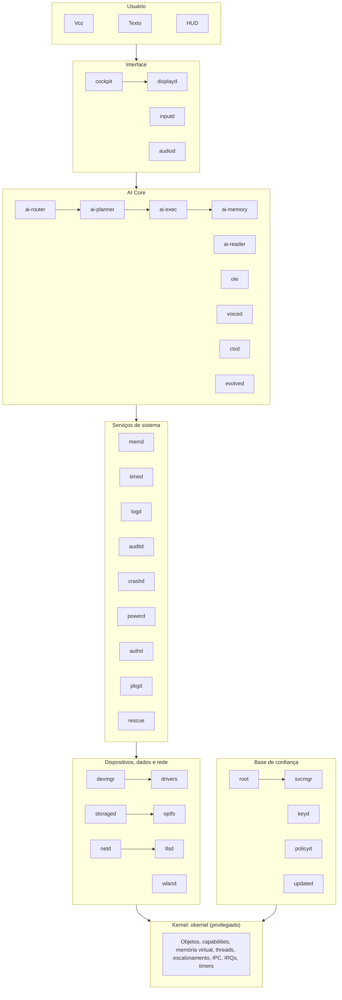

## 2. Fluxo de um pedido

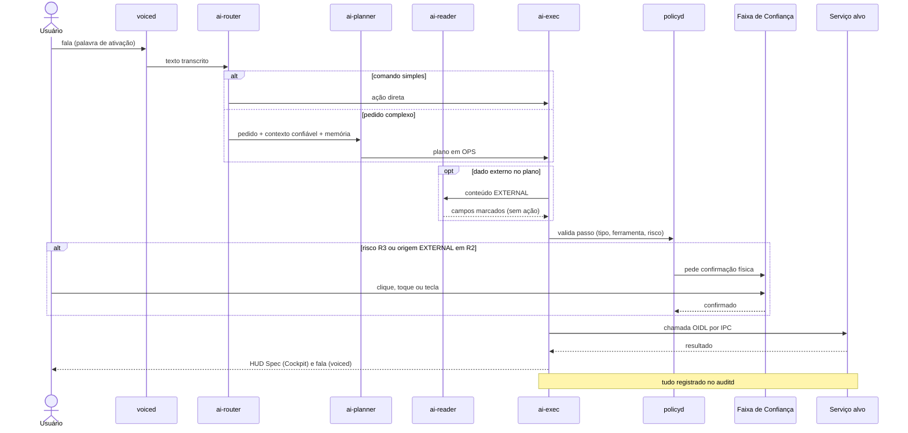

## 3. Modelo de domínio do kernel

Objetos do kernel e relações entre eles. Toda criação debita bytes de uma `MemoryQuota`.

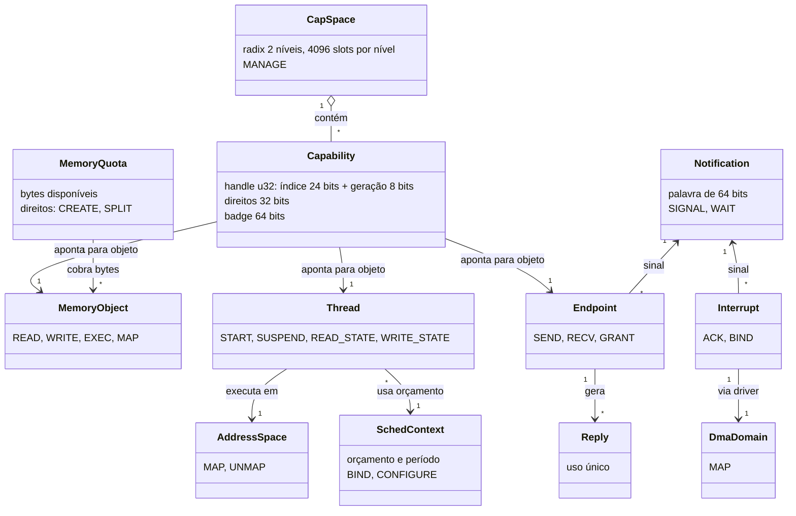

## 4. Derivação e revogação de capabilities

Regras que as provas Kani (T-204) precisam cobrir.

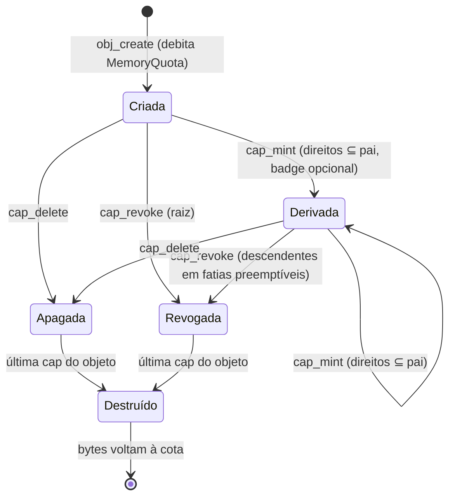

Invariantes:
- Direitos nunca aumentam ao derivar.
- Handle com geração antiga devolve `InvalidHandle`.
- Revogação não deixa descendente vivo.

## 5. Ciclo de vida de um serviço (svcmgr)

Política de reinício: `always`, `on-failure` ou `never`, com recuo exponencial de 100 ms a 30 s e limite de 5 falhas por minuto antes de alertar.

```mermaid
stateDiagram-v2
    [*] --> Parado
    Parado --> Iniciando: dependências satisfeitas (grafo acíclico)
    Iniciando --> Rodando: processo pronto
    Iniciando --> Falhou: erro de partida
    Rodando --> Falhou: processo morreu
    Falhou --> Revogando: política permite reinício
    Falhou --> Parado: política never
    Revogando --> Iniciando: capabilities revogadas e reemitidas; clientes recebem PeerClosed
    Falhou --> Alertando: 5 falhas em 1 minuto
    Alertando --> Iniciando: recuo exponencial
    Rodando --> Parado: parada solicitada
```

## 6. Modelo de capabilities de serviço (manifesto)

O manifesto declara o que o serviço **precisa** (`needs`) e o que **oferece** (`provides`). O `svcmgr` só entrega capabilities listadas no manifesto assinado.

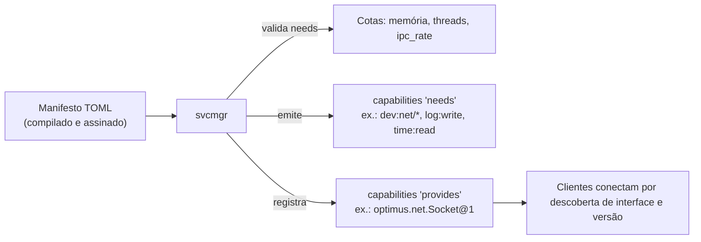

## 7. Escalonamento e prioridades

256 níveis, prioridade fixa e preemptiva. Round-robin dentro do nível, com fatia padrão de 5 ms.

| Faixa | Uso |
|---|---|
| 240–255 | Áudio, entrada, compositor (tempo real) |
| 200–239 | Drivers |
| 128–199 | Serviços de sistema e `ai-exec` |
| 64–127 | Apps e IA em primeiro plano |
| 1–63 | Fundo: indexação, raciocínio longo, `evolved` |
| 0 | Ocioso (`mwait` / `WFI`) |

Doação de `SchedContext` em `ipc_call`: o servidor roda com o tempo do cliente, o que evita inversão de prioridade.

## 8. Ordem de locks (SMP)

Ordem fixa para evitar deadlock. A regra entre duas filas de CPU ainda está em aberto (ADR 0031).

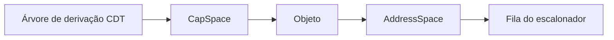

## 9. Armazenamento

Layout do disco (GPT), imagem verificada e pilha de E/S.

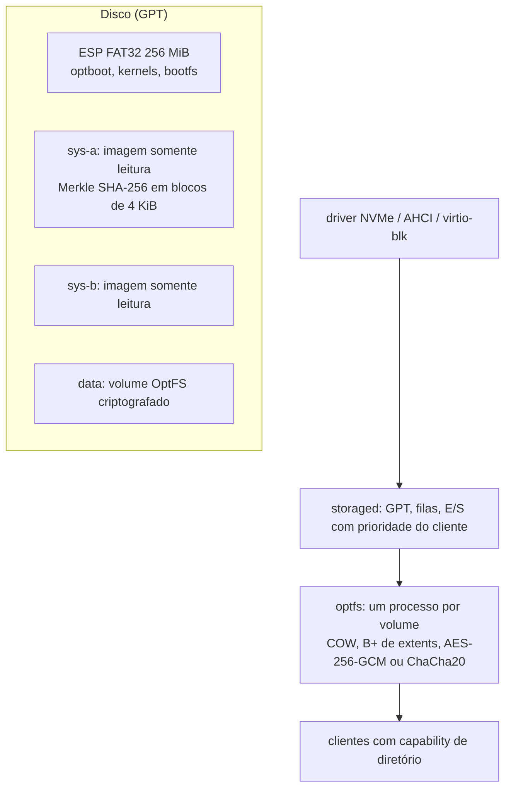

## 10. Boot e cadeia de confiança

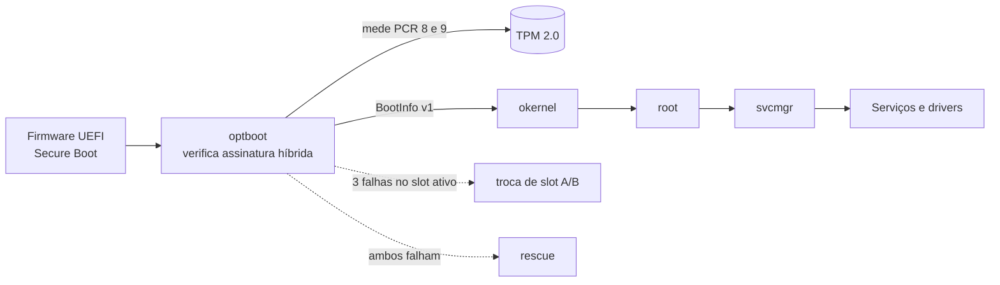

## 11. Pilha de rede

A rede é negada por padrão. Nenhum processo abre conexão sem capability `NetAccess`.

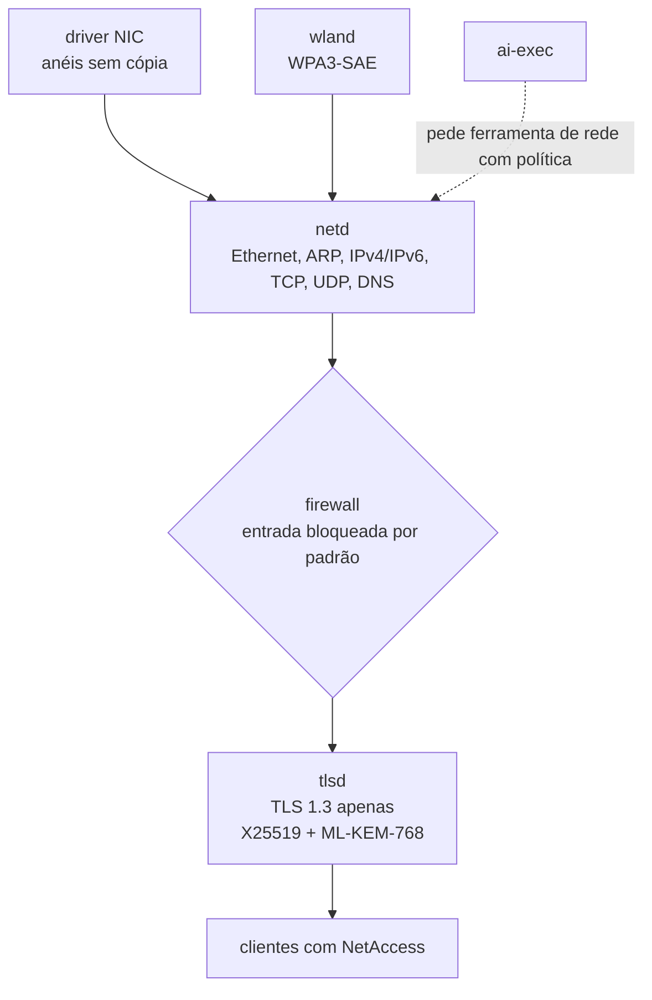

## 12. Política de risco da IA

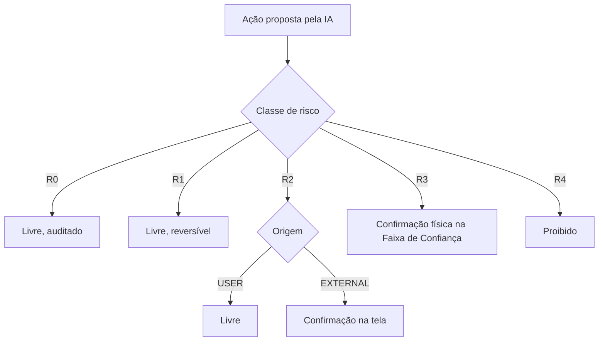

## 13. Modelo de dados da memória da IA

| Tipo | Conteúdo | Armazenamento | Regra |
|---|---|---|---|
| Episódica | Conversas e ações, com data e origem | Log criptografado em `/data/ai/episodes` | Editável e apagável pelo usuário |
| Semântica | Fatos e documentos indexados | Índice HNSW próprio + embeddings locais | Origem EXTERNAL nunca vira instrução |
| Perfil | Preferências confirmadas pelo usuário | Registro estruturado | Só entra com confirmação |
| Procedimental | Planos OPS aprovados e bem-sucedidos | Biblioteca de skills versionada | Só entra com aprovação e teste |

## 14. Rastreabilidade entre marcos e modelos

| Modelo | Marco | Tarefas do backlog |
|---|---|---|
| Objetos e capabilities (seções 3 e 4) | M2 | T-201 a T-204 |
| Escalonamento e IPC (seção 7) | M2 e M3 | T-207, T-208, T-305, T-320 a T-328 |
| Ordem de locks (seção 8) | M3 | T-314, T-315 |
| Ciclo do serviço (seção 5) | M3 | T-348 a T-354 (eventos, Timer, `svcmgr`) |
| Contratos de interface (OIDL) | M3 | T-340 a T-347 (`oidl-rt` e `oidlc`) |
| Boot e cadeia (seção 10) | M1 e M3 | T-101 a T-103, T-211 |
| Armazenamento (seção 9) | M5 | (backlog a detalhar) |
| Rede (seção 11) | M6 | (backlog a detalhar) |
| Política de risco da IA (seção 12) | M8 e seguintes | (backlog a detalhar) |

Os números T-3xx são do `docs/backlog/m3.md`. Os marcos M4 em diante ainda não têm backlog detalhado.
