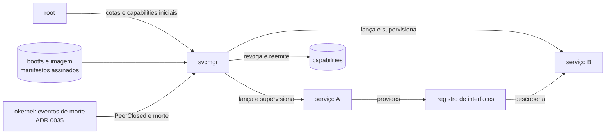

# Plano 001: `svcmgr`

- Status: **rascunho para revisão**
- Spec: [`spec.md`](spec.md)
- Pré-requisito: ADRs 0034 (manifesto, descoberta, protocolo `root`/`svcmgr`) e 0035 (eventos de ciclo de vida e Timer) aceitas.

## 1. Decisões propostas

| # | Decisão | Motivo | Alternativa descartada |
|---|---|---|---|
| D1 | `svcmgr` é um processo `no_std` sobre `ostd`, em `services/svcmgr`. | Mesmo runtime dos demais serviços (SDD 7.1). | Embutir no `root`: junta TCB e supervisor. |
| D2 | Manifesto em TOML no código, compilado para um formato binário fixo, assinado com a imagem. | SDD 14.4. Leitura sem parser TOML na TCB. | Ler TOML em tempo de boot: parser complexo na TCB. |
| D3 | Grafo de dependências verificado no build pelo compilador de manifestos (T-350) e de novo na partida. | Erro cedo, e defesa em profundidade. | Só verificar na partida: falha tarde. |
| D4 | Descoberta por interface e versão (`optimus.net.Socket@1`), não por nome de processo. | Permite trocar a implementação sem mudar clientes. | Nome fixo: acopla cliente a serviço. |
| D5 | Ao reiniciar, o `svcmgr` revoga com `cap_revoke` a árvore de capabilities do processo antigo e emite novas. | Usa o modelo de derivação já provado no M2. | Reusar capabilities antigas: quebra FR-09. |
| D6 | Recuo exponencial: 100 ms, 200 ms, 400 ms, … até 30 s. Reinicia o contador após 60 s de operação estável. | Evita tempestade de reinícios sem punir falha rara. | Recuo fixo: pior para falha em laço. |
| D7 | Alerta por janela deslizante de 60 s com contador de falhas por serviço. | Simples e testável com relógio simulado (AC-08). | Média móvel: mais código sem ganho. |
| D8 | `svcmgr` não usa alocação dinâmica além da cota recebida do `root`. | NFR-05 e ADR 0006. | `Vec` sem limite: quebra o orçamento de memória. |
| D9 | Partida em paralelo: cada serviço sem dependências pendentes é lançado numa thread do `svcmgr`. | Velocidade de boot (SDD 15.2). | Sequencial: lento, mas mais simples. Aceitável só se o paralelo atrasar o M3. |

## 2. Arquitetura



## 3. Interfaces

### 3.1 Com o `root`

Protocolo de uso único na partida. O `root` entrega ao `svcmgr` um endpoint, uma `MemoryQuota` e as capabilities de bootfs. Depois disso, o `root` só atende ao `svcmgr`.

Como o SDD 4.3 exige OIDL para toda chamada entre processos, e o OIDL do M3 ainda está sendo implementado (T-340 a T-347), este protocolo é a **exceção documentada** do item 19 do backlog. A ADR 0034 precisa registrar isso, com prazo para migrar.

### 3.2 Com os serviços

- `svcmgr` → serviço: capabilities na partida, e a notificação de encerramento via `obj_bind_notify` (ADR 0035).
- Cliente → `svcmgr`: pedido de descoberta por interface e versão. Interface em OIDL, gerada pelo `oidlc`.

Exemplo do esquema OIDL (a ser fechado na ADR 0034):

```
package optimus.svc @1.0;

interface Registry {
    @tool(risk = R0, desc = "Localiza um serviço por interface e versão")
    find(iface: string<128>, version: u32) -> result<handle<Endpoint>, SvcError>;
}
```

## 4. Máquina de estados do serviço

Vale para cada serviço supervisionado. O diagrama completo está em `docs/prd/modelagem.md`, seção 5.

| Estado | Entrada | Saída |
|---|---|---|
| Parado | Dependências satisfeitas | Iniciando |
| Iniciando | Processo criado | Rodando, ou Falhou |
| Rodando | Processo morreu | Falhou |
| Falhou | Política `always` ou `on-failure` | Revogando |
| Falhou | Política `never` | Parado |
| Revogando | Capabilities revogadas | Iniciando (com recuo) |
| Alertando | 5 falhas em 60 s | Iniciando (com recuo máximo) |

## 5. Plano de testes

Seguindo o SDD 18, para cada critério da spec:

| Nível | Ferramenta | Cobre |
|---|---|---|
| Unitário, no host | `cargo test -p svcmgr` | AC-02, AC-07, AC-08, AC-09. Máquina de estados e grafo. |
| Integração, QEMU | `cargo xtask test user` | AC-01, AC-03, AC-04, AC-05, AC-06. |
| Caos, QEMU | `cargo xtask test stress` | AC-10. |
| Modelo | TLA+ (`docs/spec/tla/`) | Invariante: nenhuma capability viva de processo morto. Estender `CapRevoke.tla`. |
| Fuzzing | okfuzz (T-330) | Parser de manifesto binário. |

Toda falha encontrada vira teste de regressão antes da correção.

## 6. Orçamento

- Tamanho alvo do `svcmgr`: ≤ 2.000 linhas de Rust (ainda não está no SDD; propor como meta na ADR 0034).
- `unsafe`: zero. Se for preciso, o caso vai para `unsafe-allowlist.toml` com teto, em PR separado com revisão dupla.
- Memória em repouso: cabe na cota do `root` (32 MiB, a fixar).

## 7. Riscos

| Risco | Impacto | Mitigação |
|---|---|---|
| ADR 0035 atrasa | FR-09 a FR-11 bloqueados | Entregar FR-01 a FR-08 primeiro e marcar FR-09 a FR-11 como pendentes na ADR |
| `svcmgr` cresce além do esperado (TCB) | Revisão fica inviável | Orçamento de linhas (seção 6) verificado no CI |
| Descoberta vira ponto único de falha | Sistema para se o `svcmgr` cair | Recuperação via `root` (pergunta 4 da spec); teste de caos |
| Manifesto sem assinatura no M3 | Serviço adulterado no bootfs | Hash do bootfs conferido pelo `optboot` (SDD 5.1); assinatura no marco seguinte |

## 8. Ordem de implementação

Segue o backlog `docs/backlog/m3.md`:

1. ADR 0034 e ADR 0035 aceitas (pré-requisitos, fora deste plano).
2. T-350: compilador de manifestos.
3. T-351: `root` com cotas e partida do `svcmgr`.
4. T-352: `svcmgr` com manifestos, grafo e partida paralela.
5. T-353: corretor de capabilities (`needs`/`provides`).
6. T-354: supervisão e reinício (depende de T-348 e T-349).

## 9. Definição de pronto

Além da constituição (Art. 6):

- Todos os critérios AC-01 a AC-11 verdes, ou AC-11 explicitamente adiado pela ADR 0035.
- Revisão dupla registrada, por ser TCB.
- `docs/backlog/m3.md` atualizado com o status de T-350 a T-354.
